# Model Chat

Spawn 5 Gemini instances into a shared conversation room.  They debate a problem across 5 rounds using round-robin turns (all agents respond in parallel each round, see full history).  A synthesizer agent then merges the debate into a final answer.

**Why this works:** Same model, slight framing variations = systematically different failure modes.  Surfacing disagreements between instances is more valuable than any single instance's confident answer.  Consensus across independent runs filters hallucinations; divergences reveal genuine judgement calls.

## Execution

### 1. Parse the request

Extract from the user's message:

- **Topic/problem** to debate
- **Mode**: auto (default) or interactive (`--interactive` flag)
- **Agent count**: default 5, user can override
- **Round count**: default 5, user can override

### 2. Run the orchestration script

```powershell
cd "G:\My Drive\AI\Skills" && .venv/bin/python .agent_chatroom.py "<topic>"
```

For interactive mode:

```powershell
cd "G:\My Drive\AI\Skills" && .venv/bin/python .agent_chatroom.py "<topic>" --interactive
```

Optional CLI parameters:

```powershell
# Custom agent count and rounds
cd "G:\My Drive\AI\Skills" && .venv/bin/python .agent_chatroom.py "<topic>" --agents 7 --rounds 4

# Save debate transcript and final synthesis to custom paths
cd "G:\My Drive\AI\Skills" && .venv/bin/python .agent_chatroom.py "<topic>" --output "debate_summary.md" --transcript "debate_transcript.jsonl"
```

| Parameter | Type | Default | Description |
| :--- | :--- | :--- | :--- |
| `<topic>` | String | (Required) | The core question, architectural dilemma, or strategic problem to debate. |
| `--interactive` | Flag | `False` | Pauses after each round to accept human moderator guidance or steering prompts. |
| `--agents` | Integer | `5` | Number of debating agent personas to spawn (minimum 3, recommended 5–8). |
| `--rounds` | Integer | `5` | Number of round-robin debate rounds before dispatching the Synthesizer. |
| `--model` | String | `'inherit'` | Underlying model tier (`'flash'` for speed/cost, `'pro'` for deep architecture). |
| `--output` | Path | `debate_summary.md` | Path to save the final synthesized consensus report. |
| `--transcript`| Path | `debate_transcript.jsonl` | Path to record the chronological structured turn transcript. |

## 3. System Architecture & Lifecycle

```mermaid
flowchart TD
    User["User Request: Topic & Parameters"] --> Orchestrator["Orchestrator Agent"]
    
    subgraph Round1 ["Round 1: Initial Stance & Solution Proposal (Parallel)"]
        A1_R1["Agent 1: Pragmatist"]
        A2_R1["Agent 2: Skeptic / Red Teamer"]
        A3_R1["Agent 3: Scalability Architect"]
        A4_R1["Agent 4: Security & Resilience"]
        A5_R1["Agent 5: UX / DX Advocate"]
    end
    
    Orchestrator --> Round1
    Round1 --> History1["Append to Shared Transcript"]
    
    subgraph Round2 ["Round 2: Cross-Examination & Direct Critiques (Parallel)"]
        A1_R2["Agent 1 Rebuttal"]
        A2_R2["Agent 2 Rebuttal"]
        A3_R2["Agent 3 Rebuttal"]
        A4_R2["Agent 4 Rebuttal"]
        A5_R2["Agent 5 Rebuttal"]
    end
    
    History1 --> Round2
    Round2 --> History2["Append to Shared Transcript"]
    
    subgraph MidRounds ["Rounds 3-4: Defense, Concession & Convergence"]
        R3["Round 3: Defense & Concessions"]
        R4["Round 4: Cross-Pollination & Hybrid Ideas"]
    end
    
    History2 --> MidRounds
    MidRounds --> History4["Append to Shared Transcript"]
    
    subgraph Round5 ["Round 5: Closing Positions & Final Vote (Parallel)"]
        A1_R5["Agent 1 Close"]
        A2_R5["Agent 2 Close"]
        A3_R5["Agent 3 Close"]
        A4_R5["Agent 4 Close"]
        A5_R5["Agent 5 Close"]
    end
    
    History4 --> Round5
    Round5 --> FullTranscript["Complete Multi-Round Transcript"]
    
    FullTranscript --> Synthesizer["Synthesizer Agent (Chief Arbiter)"]
    Synthesizer --> FinalReport["Executive Decision & Consensus Report"]
```



## 4. Cognitive Lenses & Viewpoint Variations

To maximize cognitive diversity and prevent uniform failure modes, each participating agent is assigned a distinct operational lens while examining identical problem constraints and context:

| Agent # | Persona / Cognitive Lens | Core Mandate & Framing Directive |
| :--- | :--- | :--- |
| **Agent 1** | **The Pragmatist / Minimalist** | *"Prioritize immediate feasibility, simplicity, lowest operational overhead, standard tooling, and rapid time-to-value. Vigorously reject speculative over-engineering."* |
| **Agent 2** | **The Skeptic / Red Teamer** | *"Actively search for failure modes, edge cases, unstated assumptions, single points of failure, hidden dependencies, and systemic risks. Challenge accepted wisdom."* |
| **Agent 3** | **The Scalability / Systems Architect** | *"Optimize for long-term modularity, clean boundaries, decoupling, high-throughput elasticity, maintainability, and forward-compatible extensibility (10x scale)."* |
| **Agent 4** | **The Security & Resilience Purist** | *"Focus strictly on failure blast radiuses, data privacy, defense-in-depth, zero-trust boundaries, error containment, auditability, and catastrophic recovery."* |
| **Agent 5** | **The UX / DX & Ergonomics Advocate** | *"Evaluate through the human lens: end-user friction, developer cognitive overhead, onboarding velocity, API elegance, and operational ergonomics."* |

*(For runs with $N > 5$, assign supplemental lenses: **Agent 6: Cost & Token/Compute Optimizer**, **Agent 7: First-Principles Contrarian**, **Agent 8: Execution Velocity / Fast MVP**).*

## 5. Turn-by-Turn Debate Progression (The 5-Round Arc)

Each round executes with **parallel responses** from all $N$ agents. Before generating their response for Round $R$, every agent receives the complete chronological debate history from Rounds $1$ through $R-1$.

### Round 1: Thesis & Baseline Proposal

- **Objective:** Stake out distinct, well-reasoned baseline positions.
- **Agent Instructions:**
  - Formulate your core thesis and recommended approach in 2–3 concise paragraphs.
  - State your primary success metric and the #1 trade-off you are willing to make based on your assigned lens.
  - Propose one concrete architecture, action, or design choice.

### Round 2: Cross-Examination & Direct Critique

- **Objective:** Stress-test other agents' proposals; expose hidden flaws.
- **Agent Instructions:**
  - Review all Round 1 proposals from your peers.
  - Directly challenge at least two specific points or trade-offs proposed by named peer agents.
  - Demonstrate why their approach fails under stress, incurs unacceptable costs/risks, or misses critical blind spots.

### Round 3: Defense, Concession, & Refinement

- **Objective:** Prevent stubborn entrenchment; reward rational adaptability.
- **Agent Instructions:**
  - Respond to direct critiques levied against your position during Round 2.
  - **Mandatory Concession:** Explicitly acknowledge at least one valid risk, blind spot, or constraint raised by a peer.
  - Present a hardened, amended version of your original proposal that accommodates this concession without abandoning your core lens.

### Round 4: Cross-Pollination & Convergence

- **Objective:** Bridge ideological divides and formulate hybrid solutions.
- **Agent Instructions:**
  - Identify emerging areas of agreement across the room.
  - Propose a hybrid compromise: *"How can we reconcile Agent 1's simplicity with Agent 3's scalability while respecting Agent 2's failure warnings?"*
  - Isolate any remaining irreconcilable trade-offs that represent genuine philosophical forks.

### Round 5: Closing Statements & Definitive Stance

- **Objective:** Force final position settlement and voting.
- **Agent Instructions:**
  - Deliver your final 3-bullet summary stance.
  - Explicitly vote for the best converged solution surfaced during the debate.
  - State your non-negotiable invariant that the final implementation must uphold.

## 6. Shared State & Communication Protocol

### Central Transcript Formats

Debates are logged concurrently in two synchronized files:

- **`debate_transcript.jsonl`**: Machine-parseable log containing per-turn metadata for orchestrator tracking.
- **`debate_transcript.md`**: Live-updated Markdown room transcript for observation, streaming, and human review.

#### JSONL Message Schema

```json
{
  "round": 1,
  "agent_id": "Agent-2-Skeptic",
  "lens": "The Skeptic / Red Teamer",
  "timestamp": "2026-10-23T17:30:00Z",
  "content": "Full text of turn response...",
  "critique_targets": ["Agent-1-Pragmatist"],
  "concessions_made": []
}
```

#### Concurrency & File Safety Rules

1. **Synchronized File Appends:** When multiple threads or subagents write concurrently to shared transcript files (`.jsonl`, `.txt`, `.md`), wrap all writes in a `threading.Lock()` and flush immediately (`f.flush()`) to prevent interleaved lines and corrupted JSON.
2. **Resilient Streaming:** When reading or streaming JSONL logs, handle `json.JSONDecodeError` on a per-line basis so that any partially written line never crashes the reader or orchestrator status loop.

### Interactive Mode Workflow (`--interactive`)

1. At the completion of each round, the orchestrator pauses execution.
2. A compact summary of the latest round is presented to the user.
3. The user may:
   - Press **Enter** to continue directly to the next debate round.
   - Inject a **Moderator Note** (e.g., *"Assume AWS serverless architecture only"* or *"Budget is capped at \$500/month"*). The orchestrator prepends this instruction to all agents' context in the subsequent round.

---

## 7. The Synthesizer Agent (Convergence & Resolution)

Once Round 5 concludes, the Orchestrator dispatches the **Synthesizer Agent**.

### Synthesizer Role & System Prompt

The Synthesizer acts as an impartial Chief Technology Officer / Executive Arbiter who was not a debater and holds no allegiance to any single lens.

```text
You are the Executive Synthesizer and Chief Arbiter. You have observed a vigorous 5-round multi-agent debate among specialized agent personas on the topic: "<TOPIC>".

Your mandate:
1. Objectively evaluate the full multi-round debate transcript.
2. Identify Universal Consensus: Highlight foundational axioms and choices universally agreed upon by Round 5.
3. Map Key Dialectics & Concessions: Document how conflicts between competing perspectives (e.g., speed vs. security, simplicity vs. scalability) evolved and converged.
4. Filter Hallucinations & Noise: Discard ungrounded claims, non-existent packages, or flawed logic debunked during cross-examination.
5. Deliver the Authoritative Recommendation: Provide a cohesive, actionable, and phased blueprint that delivers the optimal path forward while hedging against the risks surfaced during the debate.
```

## 8. Final Report Output Schema

The final synthesized result is saved to `debate_summary.md` (or displayed directly in the chat):

```markdown
# Multi-Agent Debate Synthesis: [Topic / Problem Statement]

**Metadata:** [N] Agents | [R] Rounds | Mode: [Auto / Interactive] | Date: [YYYY-MM-DD]

---

## 1. Executive Summary & Recommended Decision

[Clear, definitive decision synthesized from the debate. States the recommended architecture, core trade-offs made, and the strategic rationale.]

## 2. Universal Points of Consensus (Room Invariants)

- **Consensus Item 1:** [Architecture, library, or constraint agreed upon by all agents]
- **Consensus Item 2:** [Universally rejected anti-pattern or discarded approach]

## 3. Key Clashes & Dialectical Resolutions

| Conflict / Debate Clash | Competing Viewpoints | Pivotal Concession / Insight | Final Resolution |
| :--- | :--- | :--- | :--- |
| **Simplicity vs. Scalability** | Pragmatist vs. Systems Architect | Architect conceded that MVP must ship within 2 weeks | Phase 1 simple monolith; modular boundaries prepared for Phase 2 |
| **Latency vs. Security** | Pragmatist vs. Security Purist | Pragmatist conceded need for tamper-proof audit trails | Out-of-band asynchronous audit logging |

## 4. Actionable Implementation Blueprint

1. **Phase 1: Immediate Baseline:** [Concrete first steps that balance speed and safety]
2. **Phase 2: Scale & Hardening:** [Mid-term enhancements to address long-term stability]
3. **Guardrails & Risk Mitigations:** [Specific risk hedges directly addressing Skeptic/Security findings]

## 5. High-Value Outliers & Novel Angles

- **[Agent X / Lens]:** [Unconventional observation, unique failure mode, or creative tool suggestion that a single LLM prompt would have missed.]

<details>
<summary><b>Click to expand full multi-round debate transcript</b></summary>

### Round 1

[Transcripts...]

### Round 2

[Transcripts...]

### Round 3

[Transcripts...]

### Round 4

[Transcripts...]

### Round 5

[Transcripts...]

</details>
```

## 9. Native Subagent Fallback Protocol

If `.agent_chatroom.py` is not executed via external script, the Orchestrator executes this protocol natively using `invoke_subagent`:

1. **Initialize Workspace State**: Create `debate_transcript.md` and `debate_transcript.jsonl`.
2. **Execute Rounds 1 to 5 Sequentially**:
   - For each round $r \in [1, 5]$:
     - Formulate parallel prompt payloads for all $N$ agents containing:
       - Problem statement & background.
       - Assigned persona/lens instructions.
       - Round-specific goals (from Section 5).
       - Full transcript from rounds $1 \dots r-1$.
     - Dispatch all $N$ agents concurrently in a single turn using `invoke_subagent`.
     - Collect completed turns, log each to `debate_transcript.jsonl` (with lock), and append formatted text to `debate_transcript.md`.
     - *(If interactive, prompt user for guidance before advancing to round $r+1$)*.
3. **Dispatch Synthesizer Agent**: Pass the completed transcript to a fresh subagent with the Synthesizer prompt (Section 7).
4. **Publish Report**: Save the final output to `debate_summary.md` and present the executive summary to the user.

## 10. Guardrails & Best Practices

- **Zero Sycophancy in Early Rounds:** Penalize agents that agree too quickly in Rounds 1 and 2. Each agent must vigorously champion its assigned perspective before entertaining compromises.
- **Enforce Concessions in Round 3:** Rational debate requires acknowledging strong opposing points. If an agent stubbornly ignores valid peer critiques, prompt them specifically to identify at least one valid counter-argument.
- **Cross-Instance Hallucination Defense:** If an agent hallucinates an API, package, or standard, rely on peer cross-examination in Round 2 to challenge it. The Synthesizer must strictly exclude unverified or contested claims from the final blueprint.
- **Maintain Full Context Continuity:** Every agent in Round $R$ must receive the unedited transcript of all prior rounds so arguments evolve dynamically rather than repeating initial assertions.
