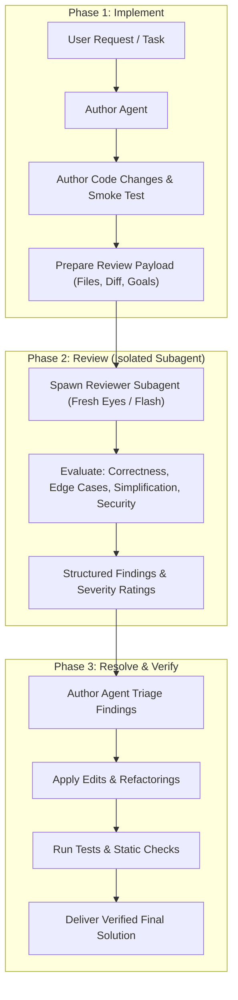

# Agent-Reviews-Agent

Three-phase chain: **Implement -> Review -> Resolve**

## When to Use

After completing any non-trivial code change, refactor, or feature implementation. Skip for single-line fixes, simple documentation edits, or basic config adjustments.

**Why this works:** The author agent suffers from natural cognitive attachment and blind spots—knowing what the code was *intended* to do obscures what it *actually* does. Spawning an isolated subagent with a fresh conversation context eliminates sunk-cost bias. The reviewer evaluates the code purely on its merits, challenging unnecessary complexity, identifying omitted edge cases, and spotting latent regressions.

## Architecture & Lifecycle



## Process

### Phase 1: Implement

1. Complete the implementation task thoroughly according to the user's requirements.
2. Conduct an initial smoke test to ensure basic functionality.
3. Identify all modified, created, or deleted files:
   - Run `git status` or `git diff --stat` to isolate touched files.
   - Formulate a brief statement of the task objectives and architectural constraints.

### Phase 2: Review

Spawn an independent reviewer subagent using `invoke_subagent` (or `Task`) configured with `subagent_type: "general-purpose"` and `model: "flash"`:

```yaml
subagent_type: "general-purpose"
model: "flash"
prompt: |
  You are an expert, adversarial code reviewer with completely fresh eyes. You have NO sunk-cost bias and zero attachment to the author's implementation. Your goal is to make this code robust, simple, and secure.

  Task Description:
  <TASK_DESCRIPTION>

  Modified Files to Review:
  <LIST_OF_FILES>

  Git Diff / Changed Content:
  <DIFF_OR_CODE_BLOCKS>

  Review the implementation rigorously across these 5 dimensions:
  1. **Correctness & Logic**: Logic errors, off-by-one errors, race conditions, async/await hazards, unhandled promise rejections, type mismatch risks.
  2. **Edge Cases & Boundary Conditions**: Null/undefined inputs, empty collections, zero values, extreme bounds, network timeouts, error propagation, resource leaks.
  3. **Simplification & Over-Engineering**: Unnecessary abstractions, dead code, duplicate helper functions, convoluted branching, premature optimizations that hurt readability.
  4. **Security & Data Safety**: Injection vulnerabilities (SQL, Command, LDAP), XSS, path traversal, secrets/token exposure, unsafe deserialization, missing authorization checks.
  5. **Conventions & Standards**: Adherence to codebase conventions, documentation integrity, error handling paradigms, and style rules.

  Output your review in the following strict structured format:

  ### Review Summary
  - **Verdict**: [APPROVED | ACTION REQUIRED]
  - **Key Strengths**: 1–2 bullets highlighting solid patterns.
  - **Overall Code Health**: [High / Medium / Needs Rework]

  ### Actionable Findings
  Categorize each issue by severity:
  - `[BLOCKER]` Critical bugs, regressions, security vulnerabilities, or broken contracts that must be fixed.
  - `[WARNING]` Latent edge cases, missing error boundaries, or performance pitfalls that should be addressed.
  - `[SIMPLIFICATION]` Opportunities to remove dead code, reduce abstraction, or make the code significantly more readable.
  - `[NOTE]` Minor stylistic suggestions or non-blocking polish.

  For each finding, provide:
  - **Location**: `path/to/file.ext#L12-L34`
  - **Issue**: Precise description of what is broken or sub-optimal.
  - **Impact**: What happens when this fails.
  - **Recommended Replacement**: Exact replacement code snippet or diff.
```

### Phase 3: Resolve

The author agent receives the reviewer subagent's structured report and executes the resolution phase:

#### 1. Triage Protocol

Evaluate every finding objectively without defensiveness:

- **`[BLOCKER]` items**: Mandatory. Must be resolved immediately before finishing the turn.
- **`[WARNING]` items**: High priority. Resolve unless there is a specific, documented architectural constraint that justifies the current design.
- **`[SIMPLIFICATION]` items**: Strongly recommended. If the reviewer demonstrated a simpler way to achieve the same result with fewer lines of code and lower cognitive load, adopt it.
- **`[NOTE]` items**: Discretionary. Apply if quick and clean; omit if purely bikeshedding.
- **Disputed Findings**: If the reviewer flagged a false positive (e.g., misunderstanding a domain-specific requirement), document the justification explicitly in the final report rather than blindly making incorrect edits.

#### 2. Execute Fixes

Apply targeted code modifications using `edit_file` or `write_file`:

- Fix bugs and close edge cases identified in `[BLOCKER]` and `[WARNING]` items.
- Remove redundant abstractions or dead code identified in `[SIMPLIFICATION]` items.
- Maintain documentation and comment integrity across all edits.

#### 3. Verification & Validation

Confirm that fixes resolved the issues without introducing new regressions:

- Run the project's test suite:

  ```powershell
  # Examples based on project stack
  pytest
  npm test
  cargo test
  dart test
  ```

- Run linters or type checkers:

  ```powershell
  # Examples based on project stack
  npm run lint
  dart analyze
  mypy .
  ```

## 4. Final Review & Resolution Report

After completing Phase 3, present a concise report to the user summarizing the review loop:

```markdown
# Self-Review & Resolution Summary

**Target Task:** [Brief summary of the feature or fix]  
**Reviewer Model:** Flash (Fresh Eyes) | **Status:** [Resolved & Verified]

### 1. Issues Identified & Remediated

- **[BLOCKER Fixed]** `src/auth/session.ts#L42`: Fixed race condition in token refresh by introducing a mutex lock.
- **[WARNING Fixed]** `src/api/handler.py#L88`: Handled empty list payload to prevent `IndexError` on zero-item requests.
- **[SIMPLIFICATION Applied]** `src/utils/parser.ts#L15`: Replaced a 35-line custom regex parser with built-in standard library parsing.

### 2. Disputed / Retained Items

- **[WARNING Deferred]** `src/db/repo.py#L120`: Reviewer suggested adding Redis caching; retained direct DB query because row count is capped at 5 records and caching adds unwarranted infrastructure overhead.

### 3. Verification

- Unit test suite: Passed (X tests, 0 failures)
- Linter / Static analysis: Clean (0 warnings)
```

## Guardrails & Best Practices

1. **Strict Context Isolation**: Always spawn the reviewer in a fresh subagent context. Re-reading code within the same context window perpetuates attention bias and misses obvious flaws.
2. **Reviewer Must Not Edit Directly**: The reviewer agent is read-only. It inspects and recommends. The author agent is responsible for executing edits to maintain overall coherence and verify tests.
3. **Prevent Review Churn**: Run a maximum of **one** review loop by default. Only re-review if Phase 3 required a massive architectural rewrite of over 50% of the codebase.
4. **Ruthless Simplification**: Give high weight to the reviewer's simplification suggestions. Code deleted is code that cannot break.
5. **No Blind Compliance**: The author agent remains the owner of the feature. If a suggestion from the reviewer is factually incorrect, reject it with clear reasoning.
