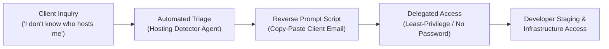

# 🌐 Client Web Infrastructure & Access Onboarding Guide

> [!NOTE]
> This guide is designed for external web developers and designers who need to quickly determine where a customer is hosted, access their admin panels, and obtain developer permissions without compromising security or overwhelming non-technical clients.

---

## 📋 The Prompt Contract



| Dimension | Specification |
| :--- | :--- |
| **Developer Role** | External Web Developer & UI/UX Designer |
| **End-User Persona** | Non-technical business owner or marketing manager |
| **Security Protocol** | Least-privilege delegated access (no master password or 2FA sharing) |
| **Primary Artifact** | [`CLIENT_ONBOARDING_TECHNICAL_FAQ.md`](file:///g:/My%20Drive/AI/website-evaluator/CLIENT_ONBOARDING_TECHNICAL_FAQ.md) |
| **Iceberg Pattern** | Operational summary surface (chat & checklist) + Deep technical instructions (disk) |

---

## 🧊 Iceberg Context Architecture

1. **Surface Layer (Actionable Front-End)**:
   - Automated hosting detection using [`hosting_detector_agent.py`](file:///g:/My%20Drive/AI/website-evaluator/hosting_detector_agent.py).
   - 3-question diagnostic tree to identify missing account credentials.
   - Pre-formatted copy-paste email templates.

2. **Deep Technical Layer (Persistent Knowledge Base)**:
   - Step-by-step delegate invite pathways for all top 10 nationwide platforms.
   - DNS, Nameserver, and SFTP/SSH configuration locations.
   - Secure handoff protocols and disaster recovery/emergency escalation strategies.

---

## 🏆 Top 10 Hosting Platforms Matrix

| # | Platform | Identification Footprint | Preferred Access Method | Key Admin Location |
| :---: | :--- | :--- | :--- | :--- |
| **1** | **GoDaddy** | Billing: GoDaddy; NS: `domaincontrol.com` | Delegate Access (*Products & Domains*) | Account Settings ➔ Delegate Access |
| **2** | **Hostinger** | Billing: Hostinger; Server: LiteSpeed | Account Sharing / Collaboration | Profile Icon ➔ Account Sharing |
| **3** | **Shopify** | Admin URL: `admin.shopify.com`; CNAME: `myshopify.com` | Collaborator Request (Partner Dashboard) | Settings ➔ Users & Permissions |
| **4** | **Wix** | Wix Editor; Billing: Wix.com | Invite Collaborator (*Website Manager*) | Settings ➔ Roles & Permissions |
| **5** | **Squarespace** | Billing: Squarespace; NS: `squarespacedns.com` | Invite Contributor (*Administrator*) | Settings ➔ Permissions & Ownership |
| **6** | **WordPress.com** | WP Admin URL; Billing: Automattic | Add New User (*Administrator*) | WP Admin ➔ Users ➔ Add New |
| **7** | **SiteGround** | NS: `siteground.biz`; Billing: SiteGround | Add Collaborator to Site Tools | Websites ➔ Users ➔ Collaborator |
| **8** | **Bluehost** | Billing: Bluehost / Newfold Digital | User Management / Invite Developer | Security ➔ User Management |
| **9** | **WP Engine** | Invoices: WP Engine; CNAME: `wpenginepowered.com` | Add User (*Full Access No Billing*) | User Portal ➔ Users ➔ Add User |
| **10** | **cPanel / Namecheap** | Port 2083; Billing: Namecheap / Shared Host | Profile Sharing + FTP Account | Namecheap Profile ➔ Sharing / cPanel FTP |

---

## 📬 Reverse Prompt Toolkit (Ready to Send)

### Diagnostic Script for the Client
```text
Subject: Setting up developer access for [Website Name]

Hi [Client Name],

I am preparing to start work on your website! To access the technical settings safely without needing your personal passwords, could you let me know:

1. Where do you receive recurring bills for your website or domain (e.g., GoDaddy, Hostinger, Shopify, Squarespace, Wix, Bluehost)?
2. If you are unsure, search your credit card statement or accounting records for any charges from those names.

Once we identify the host, you can send me an official "Developer Invite" via my email: [Your Developer Email].

Let me know what you find, and I'll send you simple 2-minute steps.
```
